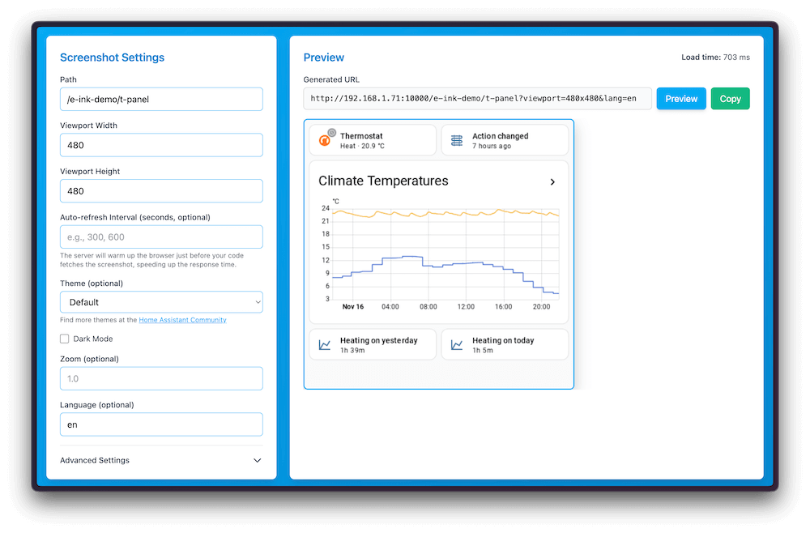
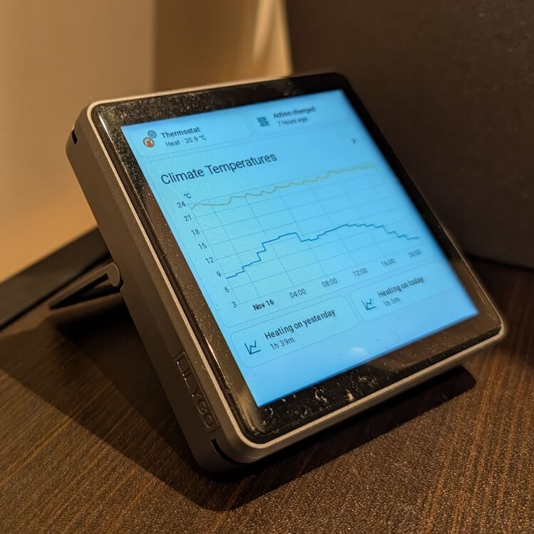

# 使用 Puppeteer 截图 Home Assistant

轻松生成您的 Home Assistant 仪表板的截图。您可以将这些截图显示在电子墨水屏或其他任何可以显示图像的屏幕上。

[](https://my.home-assistant.io/redirect/supervisor_addon/?addon=0f1cc410_puppet&repository_url=https%3A%2F%2Fgithub.com%2Fballoob%2Fhome-assistant-addons)





您需要创建一个长期有效的访问令牌，并将其作为附加组件选项添加。

启用看门狗选项，当浏览器启动失败时重启附加组件（有时会发生，仍在调查）。

_这是一个原型，没有安全保护。任何人可以访问服务器并为任何 Home Assistant 页面生成截图。_

[](./example/)

## 配置

- access_token: 用于对 Home Assistant 进行身份验证的长期有效访问令牌。

## 高级配置

- home_assistant_url: 附加组件的浏览器在抓取截图时应打开的您的 Home Assistant 实例的基础 URL。默认为 `http://homeassistant:8123`，这是附加组件可以访问 Home Assistant 的内部 URL。如果您的实例在 Home Assistant 内配置了 SSL 证书并需要通过不同的主机名或端口进行访问（例如，http://my-ha.local:8123 或 https://example.duckdns.org），则您可以覆盖它。
- keep_browser_open: 如果为 true，则在请求之间保持 Chromium 浏览器存活。

## Web UI

附加组件现在包含一个基于 Web 的用户界面，可帮助您轻松配置和预览截图。您可以通过以下方式访问它：

1. 从 Home Assistant Supervisor 界面打开附加组件的 Web UI
2. 或直接导航到 `http://homeassistant.local:10000/`

Web UI 提供：
- 交互式表单以配置截图参数（路径、视口大小、格式、主题等）
- 截图的实时预览
- 自动生成的 URL，您可以复制并用于自动化或外部应用程序

这对于测试不同设置以及在使用自动化程序之前找到完美的配置非常有用。

## 使用方式

启动附加组件将在 10000 端口上启动一个新服务器。任何您请求的路径都将返回该页面的截图。您需要指定您想要的视口大小。

例如，要获取默认仪表板的 1000px x 1000px 截图，获取：

```
http://homeassistant.local:10000/home?viewport=1000x1000
```

### e-ink 显示器

为了减少 e-ink 显示器的颜色调色板，您可以添加 `colors` 参数。值是要使用的十六进制颜色的逗号分隔列表。例如，对于 2 色 e-ink 显示器（黑色和白色）：

```
http://homeassistant.local:10000/home?viewport=1000x1000&colors=000000,FFFFFF
```

您也可以通过添加 `invert` 参数来反转颜色：

```
http://homeassistant.local:10000/home?viewport=1000x1000&colors=000000,FFFFFF&invert
```

建议使用 e-ink 主题（如 [Graphite](https://github.com/TilmanGriesel/graphite?tab=readme-ov-file#e-ink-themes)）来优化可读性。

### 设置主题

您可以通过添加 `theme` 查询参数来设置 Home Assistant 界面的截图主题。值应该是 Home Assistant 支持的主题名称（例如，`Graphite E-ink Light`）。

```
http://homeassistant.local:10000/home?viewport=1000x1000&theme=Graphite%20E-ink%20Light
```

**注意：** 主题更改适用于使用该令牌的用户的所有会话。为了避免您的常规浏览会话受到截图主题（例如 e-ink 主题）的影响，专门用于 Puppet 的创建单独的帐户并使用该用户的长期有效访问令牌在附加组件配置中。

### 完成加载检测

默认情况下，在冷启动时，服务器将在加载被认为完成后等待 2.5 秒的额外时间，以便让未被加载旋转器跟踪的内容加载（例如图标、图片）。当浏览器处于活动状态时，它等待 750ms。您可以通过添加 `wait` 查询参数来控制此等待时间。例如，等待 10 秒：

```
http://homeassistant.local:10000/home?viewport=1000x1000&wait=10000
```

您可以使用 `zoom` 查询参数控制页面的缩放级别。默认的缩放级别是 1。例如，缩放 1.3 倍：

```
http://homeassistant.local:10000/home?viewport=1000x1000&zoom=1.3
```

### 完整页面

默认情况下，截图会裁剪到视口高度。在 `viewport` 参数中将高度设置为 `auto` 以捕获整个可滚动的页面，而不是捕获扩展到折叠下方的仪表板，整个内容将在一次抓取中完成。宽度仍然适用；高度增长以适应内容，上限为 4000px，因此非常长的页面不会产生跑图。

```
http://homeassistant.local:10000/home?viewport=1000xauto
```

### 输出格式

默认情况下，输出格式为 PNG。您可以通过添加 `format=jpeg`、`format=webp` 或 `format=bmp` 查询参数请求 JPEG、WebP 或 BMP 图像：

```
http://homeassistant.local:10000/home?viewport=1000x1000&format=jpeg
```

```
http://homeassistant.local:10000/home?viewport=1000x1000&format=webp
```

```
http://homeassistant.local:10000/home?viewport=1000x1000&format=bmp
```

### 旋转截图

您可以通过添加 `rotate` 查询参数来旋转截图。有效值为 90、180 和 270。

```
http://homeassistant.local:10000/home?viewport=1000x1000&rotate=90
```

### 设置语言

您可以通过添加 `lang` 查询参数来设置 Home Assistant 界面的截图语言。值应该是 Home Assistant 支持的语言代码（例如，`en`、`nl`、`de`、`ko`、`ja`、`zh-Hans`、`zh-Hant`）。

```
http://homeassistant.local:10000/home?viewport=1000x1000&lang=nl
```

### 开启深色模式

您可以通过添加 `dark` 查询参数为截图启用深色模式。此参数不需要值。

```
http://homeassistant.local:10000/home?viewport=1000x1000&dark
```

### 预加载请求

为了提高后续请求的性能，您可以使用 `next` 参数预先安排浏览器导航到目标页面。提供*下一个*截图请求预计发生的秒数。附加组件将尝试在指定时间戳之前 10 秒浏览器的浏览器导航到指定路径。

```
# 浏览器预热以便在 300 秒后准备好抓取截图的示例
http://homeassistant.local:10000/home?next=300
```

提供 `next` 参数不会影响当前请求。它仅用于下一个请求。

## 在 Home Assistant 中使用图片

您可以使用模板图片实体将 Puppet 输出拉入 Home Assistant，以便使其可以在通知中发送或用于其他目的。

```
template:
  - image:
      name: 我的仪表板
      url: "http://homeassistant.local:10000/home?viewport=1000x1000"
```

## Proxmox

如果您在 Proxmox 虚拟机中运行 Home Assistant OS，请确保虚拟机的主机类型设置为 `host`。

## 速度（或没有速度）

此附加组件很慢。在 Home Assistant Green 上，冷启动时，需要 ~10 秒。浏览器保持在活动状态最长达 30 秒。

如果请求相同的页面，则截图尽可能快地返回（HA Green 上为 0.6 秒）。如果请求不同的页面，则需要 ~1.5 秒，因为它需要导航。

---

**⚠️ This resource is intended to help Chinese Home Assistant users more easily install excellent add-ons. If you are not a Chinese user, please read repository readme first**

**⚠️ 这个资源用来帮助中国Home Assistant用户更容易地安装优秀的插件。如果您不是中国用户，请先阅读仓库的README，以下为收集者（汉化，加速）信息，非原作者信息**

---

## 📱 关注我

扫描下面二维码，关注我。有需要可以随时给我留言：

 📲

## ☕ 赞助支持

如果您觉得我花费大量时间维护这个库对您有帮助，欢迎请我喝杯奶茶，您的支持将是我持续改进的动力！

<div style="display: flex; justify-content: space-between;">
  
  
</div> 💖

感谢您的支持与鼓励！
