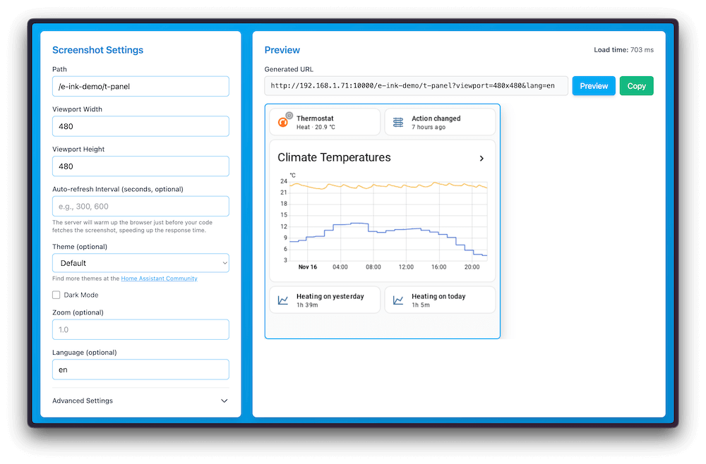
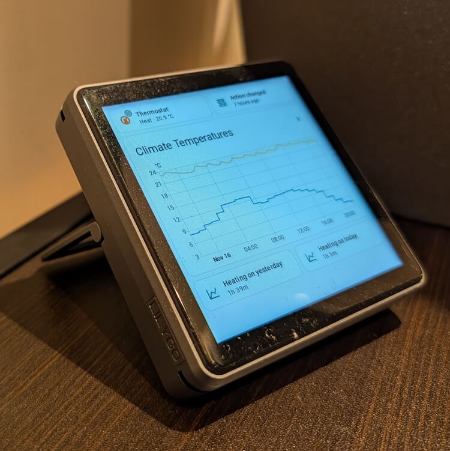

# 使用 Puppeteer 截屏 Home Assistant

轻松获取您的 Home Assistant 仪表板的截屏。将其放置于电子墨水屏或其他任何能够显示图像的屏幕上均可。

[](https://my.home-assistant.io/redirect/supervisor_addon/?addon=0f1cc410_puppet&repository_url=https%3A%2F%2Fgithub.com%2Fballoob%2Fhome-assistant-addons)





您需要创建一个长有效期访问令牌并将其作为插件选项添加。

启用看门狗选项，以便在浏览器无法启动时重启插件（偶尔会发生，仍在调查中）。

_这是一个原型，没有任何安全性。任何人都能访问服务器并获取任何 Home Assistant 页面的截屏。_

[](./example/)

## 配置

- `access_token`: 用于与 Home Assistant 进行辨别的长有效期访问令牌。

## 高级配置

- `home_assistant_url`: 插件浏览器在截屏时打开的 Home Assistant 实例的基础 URL。默认为 `http://homeassistant:8123`，这是插件能够访问 Home Assistant 的内部 URL。如果您的实例已在 Home Assistant 中配置了 SSL 证书并通过不同的主机名或端口访问（例如 `http://my-ha.local:8123` 或 `https://example.duckdns.org`），则您可以覆盖此设置。
- `keep_browser_open`: 如果为 true，则保持 Chromium 浏览器在请求之间处于活动状态。

## Web 用户界面

该插件现在包含一个基于 Web 的用户界面，可帮助您轻松配置和预览截屏。您可以通过以下方式访问它：

1. 从 Home Assistant Supervisor 界面打开插件的 Web 用户界面
2. 或直接导航到 `http://homeassistant.local:10000/`

Web 用户界面提供以下功能：
- 交互式表单以配置截屏参数（路径、视口大小、格式、主题等）
- 截屏的实时预览
- 自动生成的 URL，您可以复制并将其用于自动化或外部应用程序

这对于在自动化或外部应用程序中使用 URL 之前测试不同的设置并找到最佳配置尤其有用。

## 使用方法

启动插件将在 10000 端口上启动一个新服务器。您请求的任何路径都将返回该页面的截屏。您需要指定您想要的视口大小。

例如，要获取默认仪表板的 1000 像素 x 1000 像素截屏，请获取以下地址：

```
http://homeassistant.local:10000/home?viewport=1000x1000
```

### 电子墨水显示屏

为了减少用于电子墨水显示屏的调色板，您可以添加 `colors` 参数。值为要使用的十六进制颜色的逗号分隔列表。对于双色电子墨水显示屏（黑色和白色），例如：

```
http://homeassistant.local:10000/home?viewport=1000x1000&colors=000000,FFFFFF
```

您还可以通过添加 `invert` 参数反转颜色：

```
http://homeassistant.local:10000/home?viewport=1000x1000&colors=000000,FFFFFF&invert
```

建议使用电子墨水主题（例如 [Graphite](https://github.com/TilmanGriesel/graphite?tab=readme-ov-file#e-ink-themes)）以优化可读性。

### 设置主题

您可以通过添加 `theme` 查询参数来设置截屏中 Home Assistant 界面的主题。值应为 Home Assistant 支持的主题名称（例如 `Graphite E-ink Light`）。

```
http://homeassistant.local:10000/home?viewport=1000x1000&theme=Graphite%20E-ink%20Light
```

**注意**：主题更改会影响使用相应令牌的所有用户会话。为避免将截图主题（例如电子墨水主题）影响您的常规浏览会话，请专门创建一个用于 Puppet 的单独用户账户，并在插件配置中使用该用户的长有效期访问令牌。

### 完成加载检测

默认情况下，在冷启动时，服务器会在加载完成后额外等待 2.5 秒，以便加载未被加载旋转器跟踪的内容（例如图标、图片）。当浏览器处于活动状态时，它等待 750 毫秒。您可以通过添加 `wait` 查询参数来控制此等待时间。例如，等待 10 秒：

```
http://homeassistant.local:10000/home?viewport=1000x1000&wait=10000
```

您可以通过 `zoom` 查询参数控制页面的缩放级别。默认缩放级别为 1。例如，缩放至 1.3 倍：

```
http://homeassistant.local:10000/home?viewport=1000x1000&zoom=1.3
```

### 全屏截图

默认情况下，截屏会被裁剪至视口高度。在 `viewport` 参数中将高度设置为 `auto`，以捕获整个可滚动页面，因此向下折叠以下部分的仪表板将一次捕获完成。宽度仍然适用；高度增长以适应内容，最高限制为 4000 像素，因此非常长的页面不会产生失控的图像。

```
http://homeassistant.local:10000/home?viewport=1000xauto
```

### 输出格式

默认情况下，输出格式为 PNG。您可以添加 `format=jpeg`、`format=webp` 或 `format=bmp` 查询参数请求 JPEG、WebP 或 BMP 图像：

```
http://homeassistant.local:10000/home?viewport=1000x1000&format=jpeg
```

```
http://homeassistant.local:10000/home?viewport=1000x1000&format=webp
```

```
http://homeassistant.local:10000/home?viewport=1000x1000&format=bmp
```

### 旋转截屏

您可以通过添加 `rotate` 查询参数旋转截屏。有效值为 90、180 和 270。

```
http://homeassistant.local:10000/home?viewport=1000x1000&rotate=90
```

### 设置语言

您可以通过添加 `lang` 查询参数设置截屏中 Home Assistant 界面的语言。值应为 Home Assistant 支持的语言代码（例如 `en`、`nl`、`de`、`ko`、`ja`、`zh-Hans`、`zh-Hant`）。

```
http://homeassistant.local:10000/home?viewport=1000x1000&lang=nl
```

### 设置暗色模式

您可以通过添加 `dark` 查询参数启用截屏的暗色模式。此参数不需要值。

```
http://homeassistant.local:10000/home?viewport=1000x1000&dark
```

### 预加载请求

为了改进后续请求的性能，您可以使用 `next` 参数按提前时间调度浏览器导航到目标页面。提供您期望 *下一个* 截屏请求发生的秒数。插件将尝试在该时间戳之前 10 秒导航浏览器到指定的路径。

```
# 示例：浏览器预热 300 秒后准备好截屏
http://homeassistant.local:10000/home?next=300
```

提供 `next` 参数不会影响当前请求。它仅用于下一个请求。

## 在 Home Assistant 中使用图像

您可以使用模板图像实体将 Puppet 输出拉取到 Home Assistant 中，以便能够在通知中发送或使用其他目的。

```
template:
  - image:
      name: My dashboard
      url: "http://homeassistant.local:10000/home?viewport=1000x1000"
```

## Proxmox

如果您在虚拟机中的 Proxmox 下运行 Home Assistant OS，请确保虚拟机的主机类型设置为 `host`。

## 速度（或缓慢）

该插件较慢。在 Home Assistant Green 上，冷启动时耗时约 10 秒。浏览器最多保持活动 30 秒。

如果请求相同的页面，将尽可能快地返回截屏（HA Green 上为 0.6 秒）。如果请求不同的页面，耗时约 1.5 秒，因为需要导航。

---

**⚠️ This resource is intended to help Chinese Home Assistant users more easily install excellent add-ons. If you are not a Chinese user, please read repository readme first**

**⚠️ 这个资源用来帮助中国Home Assistant用户更容易地安装优秀的插件。如果您不是中国用户，请先阅读仓库的README，以下为收集者（汉化，加速）信息，非原作者信息**

---

## 📱 关注我

扫描下面二维码，关注我。有需要可以随时给我留言：

 📲

## ☕ 赞助支持

如果您觉得我花费大量时间维护这个库对您有帮助，欢迎请我喝杯奶茶，您的支持将是我持续改进的动力！

<div style="display: flex; justify-content: space-between;">
  
  
</div> 💖

感谢您的支持与鼓励！
